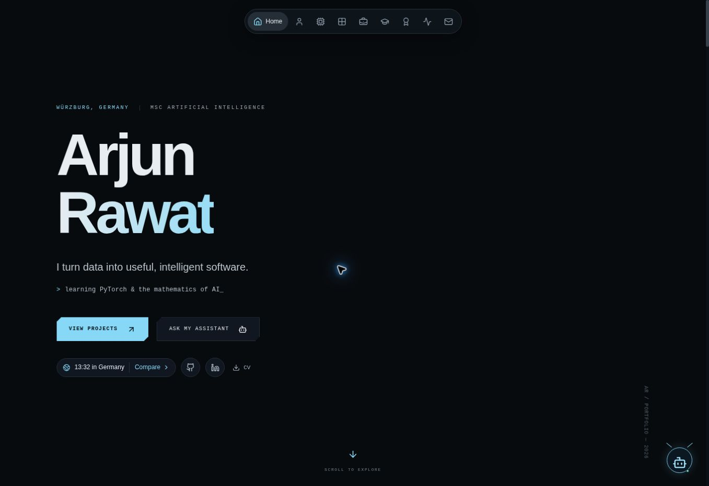

# Portfolio redesign review

## Reference observations

The supplied reference was inspected in a live browser. The reference uses a black/blue console palette, a compact icon dock, large sans-serif hero typography, a profile camera frame, six skill clusters, a moving parcel conveyor, sliding project case studies, work logs, education training panels, a step-style certification timeline, telemetry and a parcel contact form.

The reference assistant was visibly in maintenance mode, so its underlying AI behavior could not be tested. Its WebGL skills panel appeared blank in the inspection browser. The replacement uses an SVG orbit graph that also works without WebGL.

## Feature mapping

| Reference                    | Implementation                                                                     |
| ---------------------------- | ---------------------------------------------------------------------------------- |
| Hero, location, social links | Arjun’s name, Würzburg, MSc AI, GitHub, LinkedIn and retained CV                   |
| Floating dock                | Active section tracking, compact state, expanded section controls                  |
| Clock comparison             | Live timezone formatting with five comparison locations                            |
| Camera-style about panel     | Existing Arjun profile photo, detection frame and scan-line treatment              |
| Skill network                | Orbiting SVG network, category filters, pointer and keyboard rotation, pause/reset |
| Project conveyor and scanner | Four project packages, automatic/manual movement, scanner detail output            |
| Sliding mission file         | Native modal with focus handling, case study and direct project source link        |
| Shareable project pages      | Static pages for all four project slugs                                            |
| Experience and education     | Arjun’s history, separate training classification and current JMU MSc              |
| Certifications step chart    | Selected learning milestones and the complete existing learning library            |
| Telemetry                    | Actual public GitHub statistics; LeetCode/Monkeytype omitted per user choice       |
| Floating assistant           | Curated portfolio search plus optional server-configured AI generation             |
| Contact parcel               | Validated form, true delivery status, direct email and copy button                 |

## Deployment boundaries

No reference code, personal biography, certificates, photos or account statistics were copied. The existing project’s CV file remains unchanged. Missing email/AI credentials are not invented. Live email delivery and model-backed AI need deployment secrets and cannot be certified from a credential-free preview.

## Verification

- Production build and TypeScript checks passed during implementation.
- Contact-validation, HTML escaping and request-limiter regression tests pass.
- Browser inspection uses a production preview because Next’s development server encountered a memory-metrics error in the managed preview environment.
- Browser checks passed for timezone comparison, assistant launch and grounded answers, skill controls, project selection and modal dismissal, course search, milestone selection, and direct project routes.
- Missing-email-provider submission correctly shows a direct-email fallback; no live email was sent.
- A 390px static hero render was inspected. Full mobile/tablet interaction checks remain outstanding because the temporary iframe harness could not reliably load the protected pages.
- Final production build and all five regression tests passed.

