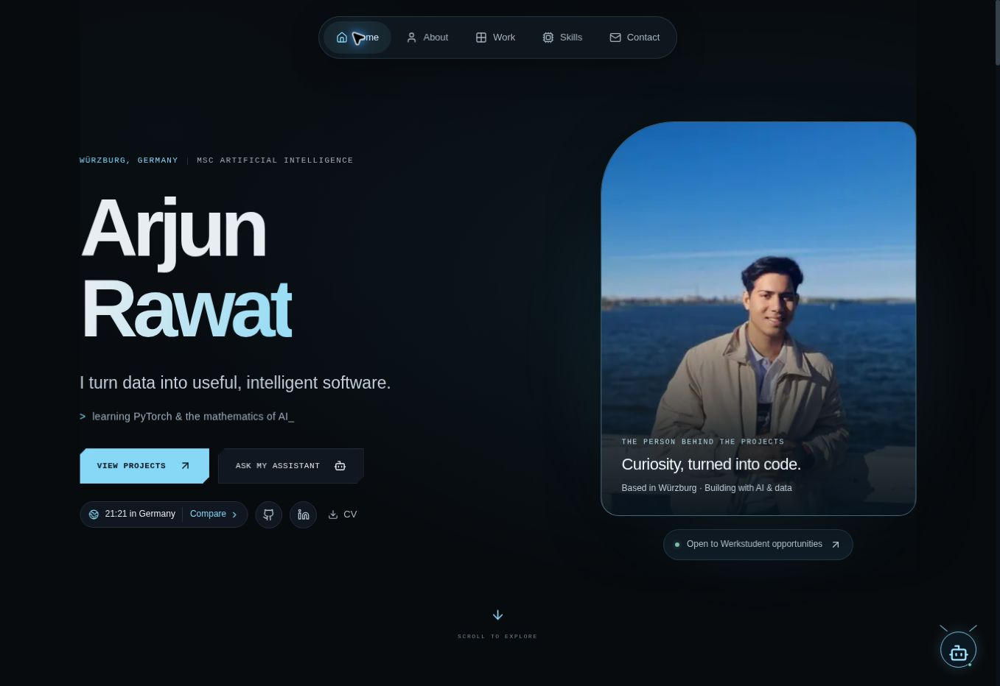

# Visual polish

The homepage now balances the name and introduction with Arjun’s existing waterfront portrait. The five labelled navigation links group the original sections, with shortcuts to experience, education, learning and GitHub activity in About.

Typography is larger and uses the system sans-serif stack for prose and tags, retaining monospace for technical labels. Subtle gradients and a skills grid add depth. Graph rotation and the project conveyor start paused and remain available through their play controls. Section entrances respect reduced-motion preferences.

The Smart Retail case study includes the actual `retail_analytics_dashboard.png` analysis output from commit `1885594006b85ad64301269f0347b8802d95331c` of `ARJUNRAWAT-DEL/Smart-Retail-Analytics-Platform`. Its original chart content is preserved. The other project repositories contained no screenshot assets, so their existing workflow diagrams remain.

Validation: production build and TypeScript checks passed. Browser checks covered labelled navigation, retail project selection, the case-study dialog and image, Escape dismissal, and graph play/pause. Static responsive renderings at 390px and 768px showed no horizontal document overflow after correcting decorative backgrounds. These responsive checks validate layout, not touch-device behavior.

